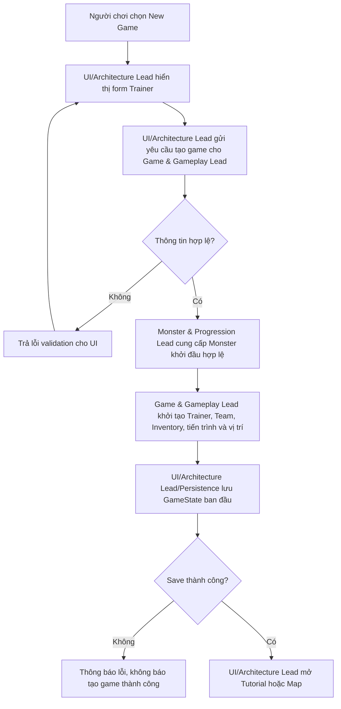
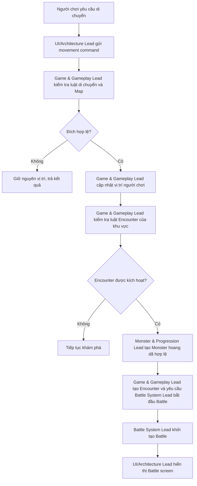
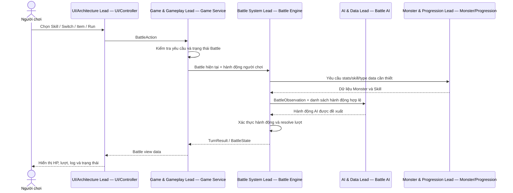
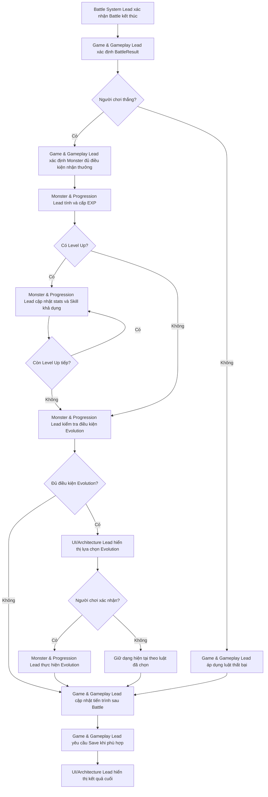
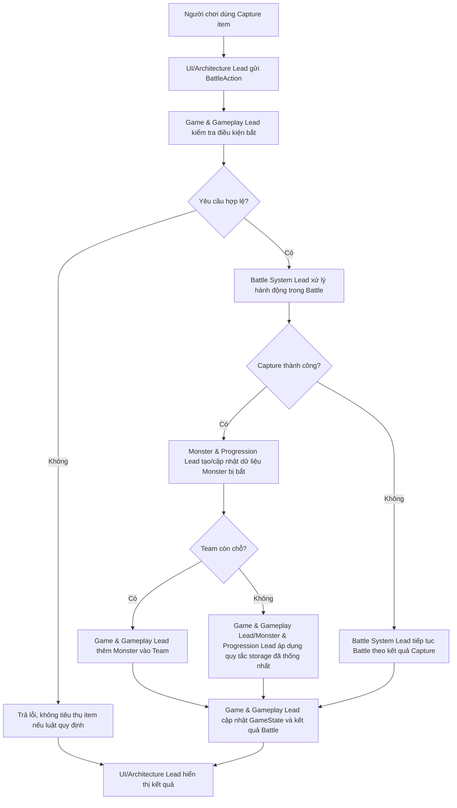
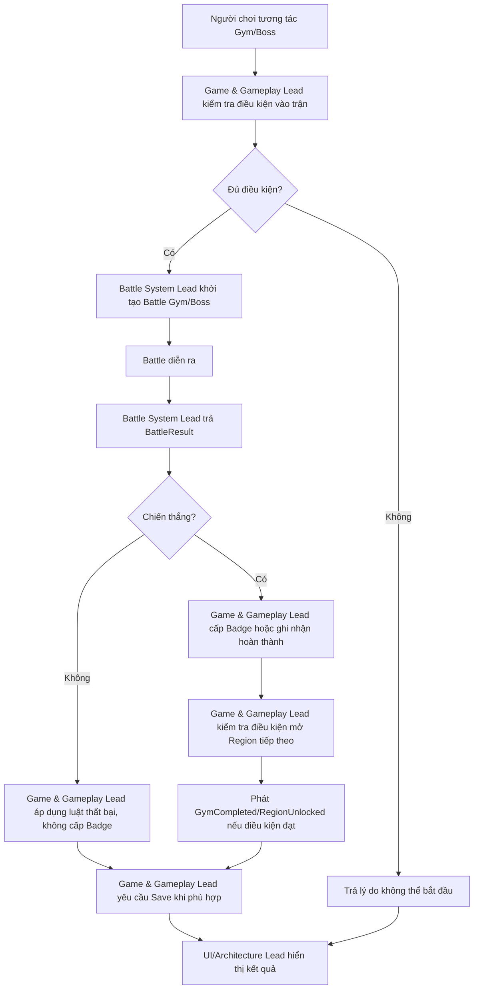
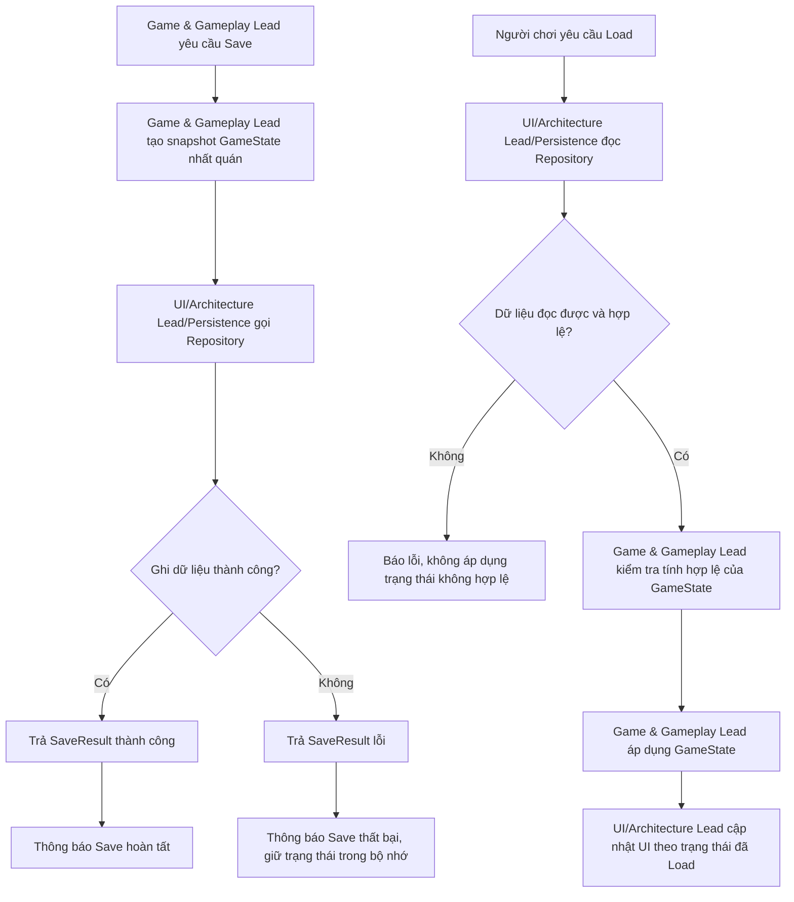
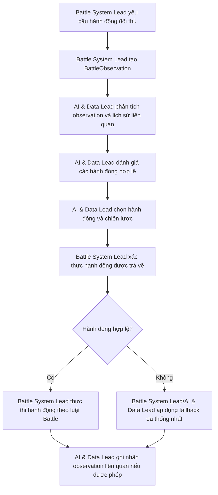

# MONSTERRA — Gameplay Integration Flows

## 1. Purpose and Scope

Chuyển các hợp đồng module thành những luồng phối hợp cụ thể, có thể triển khai và kiểm thử.

Tài liệu xác định:

- Module nào khởi tạo một luồng nghiệp vụ.
- Module tiếp theo được gọi và thứ tự phối hợp.
- Dữ liệu được truyền giữa các module.
- Điều kiện để luồng tiếp tục, kết thúc hoặc chuyển nhánh.
- Cách xử lý lỗi, thất bại và thao tác hủy.
- Thời điểm cập nhật `GameState` và thời điểm yêu cầu Save.

Game & Gameplay Lead chịu trách nhiệm xác định hành vi gameplay và trình tự nghiệp vụ. Các thành viên còn lại chịu trách nhiệm triển khai logic bên trong module của mình.

### Phạm vi

Tài liệu mô tả tám luồng tích hợp chính: New Game, Explore/Encounter, Battle Turn, Victory/Progression, Capture, Gym/Boss, Save/Load và Adaptive Battle AI.

Các quy tắc chi tiết như công thức Damage, phân chia EXP, xác suất Encounter, điều kiện Evolution và giới hạn Team phải tuân theo các tài liệu gameplay rules và module contracts đã thống nhất. Nếu một quy tắc chưa được chốt, cần ghi nhận là quyết định còn mở thay vì tự suy đoán trong lúc tích hợp.

## 2. Module Overview

| Module | Trách nhiệm chính |
| --- | --- |
| **Game & Gameplay Lead — Gameplay / Game Service** | Điều phối use case, kiểm tra luật gameplay, cập nhật tiến trình và `GameState`. |
| **Battle System Lead — Battle System** | Battle Engine, turn resolution, Damage và vòng đời Battle. |
| **Monster & Progression Lead — Monster & Progression** | Monster stats, EXP, Level, Skill, Evolution và dữ liệu phục vụ progression/capture. |
| **AI & Data Lead — AI & Data** | Phân tích thông tin Battle và đề xuất hành động AI hợp lệ. |
| **UI/Architecture Lead — UI / Controller / Persistence** | Nhận thao tác người chơi, hiển thị kết quả, điều phối controller và cung cấp Repository/Database, Save/Load infrastructure. |

`GameState` là trạng thái logic nhất quán của phiên chơi; Repository/Database là nơi lưu dữ liệu bền vững.

Sơ đồ trách nhiệm không có nghĩa mọi module phải gọi trực tiếp nhau theo một chuỗi cố định. Ví dụ, Battle System Lead có thể gọi AI & Data Lead thông qua `BattleAI` interface mà không cần biết thuật toán AI. UI không tự tính Damage hoặc EXP.

## 3. Integration Principles

1. **Game & Gameplay Lead điều phối use case:** UI gửi command đến Game & Gameplay Lead; UI không tự thực thi luật gameplay.
2. **Mỗi loại logic có một chủ sở hữu:** Battle System Lead xử lý Battle/Damage; Monster & Progression Lead xử lý Monster và progression; AI & Data Lead đề xuất hành động AI; UI/Architecture Lead xử lý giao diện và hạ tầng lưu trữ.
3. **Validate trước khi mutate:** Kiểm tra command và điều kiện hợp lệ trước khi thay đổi trạng thái.
4. **Chỉ công bố kết quả đã xảy ra:** Event như `GymCompleted` chỉ được phát khi điều kiện hoàn thành thực sự thỏa mãn.
5. **Không để module phụ thuộc vào chi tiết nội bộ không cần thiết:** Ưu tiên interface và DTO đã thống nhất.
6. **Có fallback xác định:** Các trường hợp AI lỗi hoặc dữ liệu không hợp lệ phải có cách xử lý đã thống nhất.
7. **Save có kết quả rõ ràng:** Xử lý riêng trạng thái trong bộ nhớ và kết quả ghi bền vững; không báo Save thành công khi Repository trả lỗi.
8. **Không tự đặt luật còn thiếu:** Các quy tắc chưa được quyết định phải được chốt ở gameplay rules/contracts trước khi hoàn tất tích hợp.

## 4. New Game Flow

**Mục tiêu:** Khởi tạo một game mới và đưa người chơi vào thế giới.

### Trình tự và trách nhiệm

1. UI/Architecture Lead nhận lựa chọn New Game và thu thập thông tin Trainer.
2. UI/Architecture Lead gửi yêu cầu tạo game cho Game & Gameplay Lead.
3. Game & Gameplay Lead kiểm tra yêu cầu.
4. Monster & Progression Lead cung cấp Monster khởi đầu cùng dữ liệu hợp lệ.
5. Game & Gameplay Lead khởi tạo Trainer, Team, Inventory, vị trí xuất phát và tiến trình ban đầu theo luật đã thống nhất.
6. UI/Architecture Lead/Persistence lưu `GameState` ban đầu.
7. Chỉ sau khi luồng tạo game hoàn tất theo chính sách persistence, UI mới chuyển người chơi vào Tutorial hoặc Map.

**Không tham gia trực tiếp:** Battle System Lead và AI & Data Lead không cần tham gia luồng New Game thông thường.

**Điều kiện hoàn thành:** Game mới có Trainer, Monster ban đầu, Inventory, vị trí xuất phát và `GameState` hợp lệ.

## 5. Explore and Encounter Flow

**Mục tiêu:** Xử lý di chuyển trên Map và bắt đầu Encounter khi điều kiện gameplay cho phép.

### Quy tắc tích hợp

- Di chuyển đến tile không hợp lệ thì không thay đổi vị trí.
- Chỉ kiểm tra Encounter tại khu vực cho phép.
- Xác suất Encounter và cách tạo Monster phải theo cấu hình gameplay.
- Khi Battle bắt đầu, việc di chuyển bị tạm dừng.
- Chỉ có một Battle đang hoạt động trong một phiên chơi.

**Điều kiện hoàn thành:** Hoặc vị trí được cập nhật và người chơi tiếp tục khám phá, hoặc Encounter được tạo hợp lệ và Battle bắt đầu.

## 6. Battle Turn Flow

**Mục tiêu:** Nhận hành động người chơi, lấy hành động đối thủ và phân giải một lượt Battle.

Thứ tự chính xác của turn resolution phải được Battle System Lead xác nhận theo luật chiến đấu đã thống nhất. Ví dụ, thời điểm gọi AI có thể phụ thuộc loại Battle và loại hành động.

### Contract đề xuất

| Giao tiếp | Input | Output |
| --- | --- | --- |
| UI/Architecture Lead → Game & Gameplay Lead | `BattleAction` | Kết quả tiếp nhận/xử lý yêu cầu |
| Game & Gameplay Lead → Battle System Lead | Battle hiện tại + hành động người chơi | `TurnResult` hoặc trạng thái lỗi |
| Battle System Lead → AI & Data Lead | `BattleObservation` + danh sách hành động hợp lệ | Hành động AI được đề xuất |
| Battle System Lead ↔ Monster & Progression Lead | Monster stats, Skill data, Type data | Dữ liệu tính toán Battle |
| Game & Gameplay Lead → UI/Architecture Lead | Battle view data | HP, lượt, log, trạng thái Battle |

**Ranh giới trách nhiệm:** Battle System Lead xử lý Damage và kết quả lượt chiến đấu; Monster & Progression Lead sở hữu mô hình Monster và quy tắc progression. Không để cả Battle System Lead và Monster & Progression Lead tự tính cùng một loại dữ liệu.

## 7. Victory and Progression Flow

**Mục tiêu:** Sau khi Battle kết thúc, xác định kết quả và áp dụng progression tương ứng.

### Các quyết định Game & Gameplay Lead phải chốt

1. Monster nào được nhận EXP?
2. EXP được phân chia theo quy tắc nào?
3. Khi lên nhiều Level, hệ thống có xử lý liên tiếp không?
4. Evolution có bắt buộc ngay lập tức hay có thể trì hoãn?
5. Nếu người chơi từ chối Evolution, điều kiện có còn được giữ lại không?
6. Nếu Save thất bại sau Battle, hệ thống thông báo và khôi phục như thế nào?

Đây là các quyết định thuộc gameplay rules. Trong luồng tích hợp, cần ghi rõ module nào thực thi từng quyết định và thời điểm được gọi.

## 8. Capture Flow

**Mục tiêu:** Xử lý yêu cầu bắt Monster hoang dã, xác định kết quả và cập nhật Team/storage theo luật đã thống nhất.

### Quy tắc tích hợp

- Game & Gameplay Lead kiểm tra điều kiện gameplay và điều phối use case.
- Battle System Lead xử lý kết quả hành động Capture trong ngữ cảnh Battle.
- Monster & Progression Lead cung cấp/cập nhật dữ liệu Monster.
- Nếu Team đầy, áp dụng quy tắc storage đã thống nhất; không tự chọn cách xử lý mới ở tầng UI.
- Kết quả trả về cần thể hiện rõ Capture thành công/thất bại và nơi Monster được lưu.

## 9. Gym and Boss Flow

**Mục tiêu:** Điều phối thử thách Gym/Boss và chỉ cập nhật huy hiệu hoặc mở khóa khi điều kiện hoàn thành thực sự thỏa mãn.

### Quy tắc tích hợp

- Game & Gameplay Lead kiểm tra điều kiện tham gia và điều phối tiến trình.
- Battle System Lead chịu trách nhiệm kết quả Battle.
- Chỉ cấp Badge và mở Region khi điều kiện thắng/tiến trình đã được xác nhận.
- Không phát `GymCompleted` nếu người chơi thua.
- `RegionUnlocked` chỉ được phát khi Region thực sự được mở khóa.

## 10. Save and Load Flow

**Mục tiêu:** Lưu trạng thái nhất quán và khôi phục dữ liệu hợp lệ khi Load.

### Quy tắc tích hợp

- `GameState` cần đủ dữ liệu để khôi phục phiên chơi theo hợp đồng đã thống nhất.
- Không áp dụng dữ liệu Load không hợp lệ.
- Save thất bại phải được thể hiện bằng `SaveResult` lỗi; giữ trạng thái trong bộ nhớ và thông báo người chơi.
- Chính sách Save/Exit khi Battle đang chạy phải được thống nhất trước khi triển khai.
- Luồng này không tự quyết định chiến lược backup, migration hoặc recovery nếu các nội dung đó chưa có trong persistence contract.

## 11. Adaptive Battle AI Flow

**Mục tiêu:** Để AI & Data Lead đề xuất hành động phù hợp từ thông tin Battle, trong khi Battle System Lead vẫn giữ quyền xác thực và thực thi luật chiến đấu.

### Ranh giới module

- AI & Data Lead đề xuất hành động; Battle System Lead quyết định và thực thi hành động theo luật Battle.
- AI & Data Lead chỉ được chọn trong danh sách hành động hợp lệ.
- Nếu AI không thể đưa ra hành động hợp lệ, Battle System Lead/AI & Data Lead phải có phương án fallback.
- AI không trực tiếp sửa HP, cấp EXP, thêm Monster hoặc ghi Database.
- Việc phân tích lịch sử hành động phải tuân thủ phạm vi dữ liệu đã thống nhất.

## 12. Error Handling and Fallbacks

| Tình huống | Kết quả mong đợi | Phối hợp |
| --- | --- | --- |
| Người chơi gửi Skill không hợp lệ | Không thực thi hành động; trả kết quả lỗi phù hợp | UI/Architecture Lead, Game & Gameplay Lead, Battle System Lead |
| Monster được chọn đã hết HP | Không cho Switch sang Monster đó | Game & Gameplay Lead, Battle System Lead, Monster & Progression Lead |
| AI trả về hành động không hợp lệ | Dùng fallback đã thống nhất | Battle System Lead, AI & Data Lead |
| Monster bị hạ gục giữa lượt | Kiểm tra điều kiện kết thúc và quy tắc Switch | Game & Gameplay Lead, Battle System Lead, Monster & Progression Lead |
| Capture thành công khi Team đầy | Áp dụng quy tắc storage đã thống nhất | Game & Gameplay Lead, Monster & Progression Lead |
| Load dữ liệu lỗi | Báo lỗi, không áp dụng trạng thái không hợp lệ | Game & Gameplay Lead, UI/Architecture Lead |
| Save thất bại | Thông báo thất bại, giữ trạng thái trong bộ nhớ | Game & Gameplay Lead, UI/Architecture Lead |
| Evolution bị hủy | Giữ Monster hiện tại theo luật đã chọn | Game & Gameplay Lead, Monster & Progression Lead, UI/Architecture Lead |
| Người chơi thoát khi Battle đang chạy | Áp dụng chính sách Save/Exit đã thống nhất | Game & Gameplay Lead, UI/Architecture Lead |
| Đích di chuyển không hợp lệ | Giữ nguyên vị trí hiện tại | Game & Gameplay Lead, UI/Architecture Lead |
| Chỉ định bắt đầu Battle khi Battle khác đang hoạt động | Từ chối yêu cầu theo luật một Battle/session | Game & Gameplay Lead, Battle System Lead |

Các lỗi cần được trả về theo contract rõ ràng để UI hiển thị được. Không nên để lỗi hạ tầng hoặc dữ liệu không hợp lệ làm thay đổi một phần `GameState` mà không có chính sách phục hồi.

## 13. Events and DTOs

Các kiểu dữ liệu dưới đây là đề xuất để chuẩn hóa giao tiếp. Không nhất thiết phải tạo tất cả thành class ngay lập tức; cần đối chiếu để tránh hai kiểu dữ liệu có cùng mục đích.

| Contract / DTO | Mục đích | Module chính |
| --- | --- | --- |
| `GameCommand` | Đại diện yêu cầu gameplay từ UI | Game & Gameplay Lead, UI/Architecture Lead |
| `BattleAction` | Skill, Switch, Item, Run hoặc hành động hợp lệ khác | Game & Gameplay Lead, Battle System Lead |
| `BattleObservation` | Snapshot thông tin Battle dành cho AI | Battle System Lead, AI & Data Lead |
| `TurnResult` | Kết quả một lượt Battle | Battle System Lead |
| `BattleResult` | Victory, Defeat hoặc trạng thái kết thúc khác | Game & Gameplay Lead, Battle System Lead |
| `ProgressionResult` | EXP, Level Up, Evolution eligibility | Game & Gameplay Lead, Monster & Progression Lead |
| `CaptureResult` | Kết quả bắt Monster và xử lý sức chứa | Game & Gameplay Lead, Monster & Progression Lead |
| `GameState` | Trạng thái cần khôi phục khi Load | Game & Gameplay Lead, UI/Architecture Lead |
| `SaveResult` | Kết quả lưu dữ liệu | UI/Architecture Lead |

### Events đề xuất

- `BattleStarted`
- `BattleTurnResolved`
- `BattleEnded`
- `MonsterCaptured`
- `MonsterLeveledUp`
- `EvolutionCompleted`
- `GymCompleted`
- `RegionUnlocked`
- `GameStateChanged`
- `SaveCompleted`

Chỉ phát event khi sự kiện thực sự xảy ra. Ví dụ, không phát `GymCompleted` nếu người chơi thua. Không cần triển khai event bus phức tạp nếu prototype chưa cần; callback hoặc service đơn giản có thể đủ.

## 14. Team Responsibilities

| Thành viên | Công việc | Deliverable |
| --- | --- | --- |
| **Game & Gameplay Lead** | Chốt thứ tự gameplay, điều kiện chuyển tiếp, kết quả thành công/thất bại | Gameplay Integration Flows |
| **Battle System Lead** | Xác nhận turn resolution, Battle lifecycle, kết quả Battle và fallback | Battle integration notes |
| **Monster & Progression Lead** | Xác nhận capture, EXP, Level Up, Evolution và dữ liệu Monster | Progression integration notes |
| **AI & Data Lead** | Xác nhận input/output AI, hành động hợp lệ, fallback và lịch sử | AI integration notes |
| **UI/Architecture Lead** | Xác nhận controller, persistence, DTO và cách chuyển dữ liệu | UI/Persistence integration notes |

Game & Gameplay Lead không cần tự viết toàn bộ code của các module. Game & Gameplay Lead đảm bảo quyết định gameplay được thống nhất và các module tích hợp đúng theo các quyết định đó.

## 15. Integration Acceptance Criteria

- [ ] Tám luồng tích hợp chính đã được rà soát với các thành viên liên quan.
- [ ] Mỗi luồng có điểm bắt đầu, thứ tự phối hợp, điều kiện thành công/thất bại và kết quả đầu ra rõ ràng.
- [ ] Quyền sở hữu logic giữa Dev Team không bị trùng lặp.
- [ ] DTO/interface sử dụng trong luồng đã được đối chiếu.
- [ ] Các quy tắc gameplay còn mở đã được ghi nhận và giao người quyết định; không có giả định ngầm.
- [ ] Các tình huống lỗi chính có kết quả xác định và không làm phát sinh trạng thái không hợp lệ.
- [ ] AI chỉ đề xuất hành động hợp lệ; Battle Engine giữ quyền xác thực và thực thi.
- [ ] Các event chỉ được phát khi sự kiện tương ứng thực sự xảy ra.
- [ ] Save/Load trả kết quả rõ ràng và không áp dụng dữ liệu Load không hợp lệ.
- [ ] Có thể kiểm thử từng luồng mà không cần suy đoán trình tự tích hợp từ code của module khác.